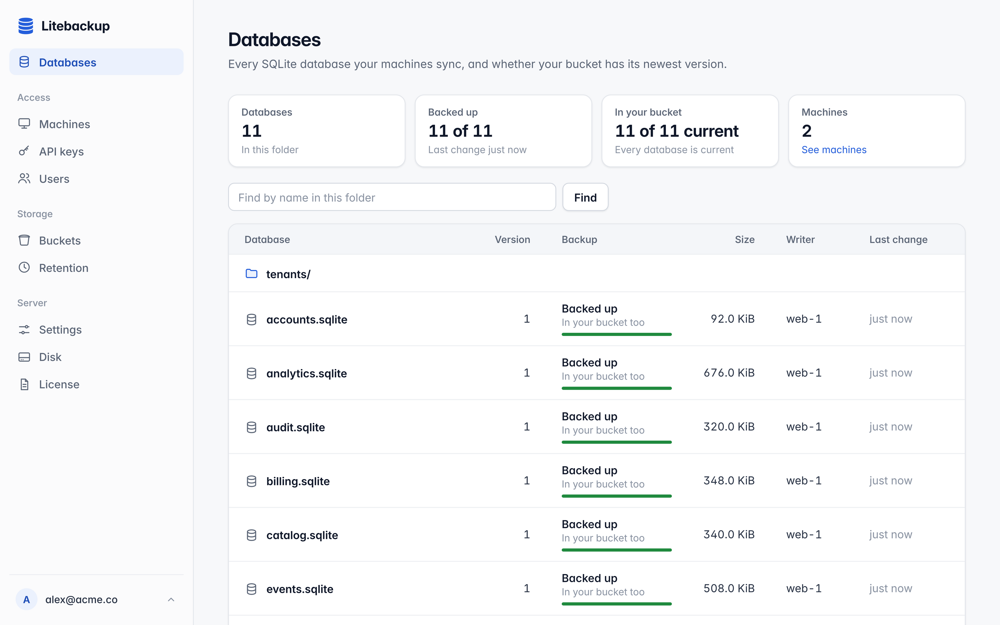

# Litebackup

**Local SQLite, synced to your cloud.**

Back up SQLite to your own server and bucket, keep live readonly replicas,
and move databases between machines. Your app keeps using its SQLite driver.

```ts
import Database from "better-sqlite3";
import { Litebackup } from "@litebackup/sdk";
import { databasePath } from "@litebackup/sdk/better-sqlite3";

const litebackup = new Litebackup();

const db = new Database("/var/lib/app/main.sqlite");
await litebackup.backups.start(databasePath(db)); // Continuous backup runs in the litebackup background process.
```

```python
import sqlite3
from litebackup import Litebackup
from litebackup.integrations.sqlite3 import database_path

db = sqlite3.connect("/var/lib/app/main.sqlite")
with Litebackup() as litebackup:
    litebackup.backups.start(database_path(db))
```

Or add backups to an existing app with the CLI:

```sh
litebackup start /var/lib/app/main.sqlite
```

https://github.com/user-attachments/assets/0a48622a-4a70-4f28-a99f-5cfa109ce421

[Website](https://litebackup.com) · [Pricing](https://litebackup.com/pricing) ·
[Documentation](docs/README.md) · [API reference](docs/sdk-reference.md)

## Install your Litebackup server

Litebackup is self-hosted. Run the server daemon on a dedicated Linux VM on AWS,
Google Cloud, DigitalOcean, Hetzner, or another provider. It receives changes
from your app machines and uploads encrypted backups to your own bucket.

For a small deployment, start with **2 vCPUs, 2–4 GB RAM, and an SSD** on a fresh
Debian 13 or Ubuntu 26.04 LTS VM, with a public IP and inbound TCP 443 open.
Size the disk for your databases, write volume, and recent history.

<a href="https://cloud.digitalocean.com/droplets/new?image=debian-13-x64&amp;refcode=13cb93d1ec16"> Create a Debian 13 Droplet on DigitalOcean</a> (referral link). Follow the [DigitalOcean setup guide](https://litebackup.com/install-digitalocean) for firewall and sizing details.

SSH into the VM and run:

```sh
curl -fsSL https://litebackup.com/server.sh | bash
```

1. Open the link the installer prints and claim your instance.
2. Add an **Amazon S3, Cloudflare R2, Google Cloud Storage, or S3-compatible bucket**.
3. Save your recovery kit or set a recovery passphrase, and choose retention.
4. Open **Machines → Add machine** to get a join token.

The installer gives you an HTTPS address and a web console. Your server
encrypts backups before uploading them. Keep your recovery kit or passphrase
off the VM; you'll need it if you lose the server.

<picture>
  <source media="(prefers-color-scheme: dark)" srcset="docs/assets/console-dark.png">
  
</picture>

[Server setup, networking, and sizing →](docs/litebackup-server.md)
[Bucket providers and permissions →](docs/sqlite-cloud-backup.md)

## Connect your app

**TypeScript / Node.js 22+**

```sh
npm install @litebackup/sdk
export LITEBACKUP_TOKEN='JOIN_TOKEN@your-instance.litebackup.cloud'
```

The package includes the Linux and macOS client (x64 and arm64). It starts
and joins automatically on first use. Keep npm optional dependencies enabled.

`LITEBACKUP_TOKEN` is the **join token plus server address** from Machines →
Add machine. A persistent session joins once and reuses its machine identity
across restarts. A fresh foreground job uses a temporary identity for that run.
See [agent fleets](docs/sqlite-fleet.md) and [serverless jobs](docs/sqlite-serverless.md).

**Python 3.11+**

```sh
pip install litebackup
export LITEBACKUP_TOKEN='JOIN_TOKEN@your-instance.litebackup.cloud'
```

Wheels for Linux (glibc and musl) and macOS, on x64 and arm64, include the
client. Elsewhere pip installs the source package, which uses an installed
`litebackup` command. Django, FastAPI, SQLAlchemy, and aiosqlite support is
in `litebackup.integrations`; see the [Python guide](python/README.md).

**CLI / Go**

Install the command on each app machine, then join as the user running your app:

```sh
curl -fsSL https://litebackup.com/cli.sh | bash
export LITEBACKUP_TOKEN='JOIN_TOKEN@your-instance.litebackup.cloud'
litebackup up "$LITEBACKUP_TOKEN"
```

```sh
go get github.com/litebackup/sdk/litebackup
```

For backups that resume after a reboot, [install the client as a service](docs/litebackup-client.md#join-and-register).
The [client guide](docs/litebackup-client.md) also covers sessions, permissions, and containers.

## Back up without slowing startup

Pass the database's path to `backups.start`. It returns when the daemon saves
the local rule; discovery and uploads run in the background. Call it on every
start: the same path and settings return the saved rule.

The opening example uses `better-sqlite3`. `@litebackup/sdk/node-sqlite`,
`@litebackup/sdk/drizzle`, and the Python integrations for sqlite3, aiosqlite,
SQLAlchemy, Django, and FastAPI get the path from the handle or configuration
the app already has. With any other driver, pass the filename. In Go,
`sqlitedsn` resolves the DSN you open:

```go
import "github.com/litebackup/sdk/litebackup"

// ctx is your application's context; the SQLite file already exists.
_, err := litebackup.StartBackup(ctx, "/var/lib/app/main.sqlite", nil)
if err != nil {
    return err
}
```

Your app writes to its local SQLite files as usual, and Litebackup syncs changes
in the background. Keep those files on a persistent disk or volume so they
remain available across restarts and redeploys.

[Drivers, frameworks, and writing an adapter →](docs/sqlite-integrations.md)
[Continuous backup, globs, and durability →](docs/sqlite-backup.md)
[Complete Go examples →](docs/sqlite-go.md)

## A database per tenant

Keep customers in separate SQLite files and give their backups stable names:

```ts
import { Litebackup } from "@litebackup/sdk";

const litebackup = new Litebackup();

await litebackup.backups.start("/var/lib/app/tenants/**/*.sqlite", { prefix: "tenants/" });
```

```sh
litebackup start '/var/lib/app/tenants/**/*.sqlite' tenants/
```

Use `litebackup rules` to find the saved backup rule. Run `litebackup stop --rule ID` to stop the entire glob, including future matches. For a file registered individually, use its remote name, such as `litebackup stop main.sqlite`.

`42.sqlite` becomes `tenants/42.sqlite`; new matching files are picked up too.
Each name has one writer. Use a prefix per shard; a second machine trying
to back up the same name reports `busy` in status.

[Tenant routing, naming, and moving a tenant between machines →](docs/sqlite-multitenancy.md)

## A database per agent

Take the agent's database for one run. The managed scope acquires it, opens
it, runs your code, closes it, and releases it; the next machine continues
from the released version.

```ts
import { mkdir } from "node:fs/promises";
import { Litebackup } from "@litebackup/sdk";
import { adapter } from "@litebackup/sdk/node-sqlite";

const litebackup = new Litebackup();

await mkdir("/var/lib/app/agents", { recursive: true });
await litebackup.databases.managed("agents/42.sqlite",
  { to: "/var/lib/app/agents/42.sqlite", durability: "cloud", offload: true, adapter: adapter() },
  (db) => {
    db.exec("CREATE TABLE IF NOT EXISTS memory (body TEXT)");
    db.prepare("INSERT INTO memory (body) VALUES (?)").run("Tests passed on main");
  });
```

`durability: "cloud"` returns once the bucket holds the run's last version;
`offload: true` then removes the local file. What the work does not commit is
rolled back. If closing the database fails, it is not released, so no other
machine writes while a connection may still be open.

[Complete agent examples, failures, retries, and local disk →](docs/sqlite-agent-state.md)

## Read from another machine

On a second machine joined to the same server:

```ts
import { Litebackup } from "@litebackup/sdk";

const litebackup = new Litebackup();

await litebackup.replicas.start("main.sqlite", { to: "/var/lib/app/reporting.sqlite" });
// The first version is local. Open reporting.sqlite with your driver in readonly mode.
```

```sh
litebackup replicate main.sqlite --to /var/lib/app/reporting.sqlite
# Or follow a whole namespace, including new databases:
litebackup replicate --prefix tenants --to /var/lib/app/replicas
```

The replica keeps updating in the background and can be behind the writer.

[Readonly connections, namespace replication, and stopping replicas →](docs/sqlite-replication.md)

## Restore a previous version

```ts
import { Litebackup } from "@litebackup/sdk";

const litebackup = new Litebackup();

console.log(await litebackup.databases.versions("main.sqlite"));
await litebackup.databases.restore("main.sqlite", {
  to: "/tmp/main-restored.sqlite",
  time: new Date("2026-11-15T09:30:00Z"),
});
```

```sh
litebackup restore main.sqlite --to /tmp/main-restored.sqlite \
  --time 2026-11-15T09:30:00Z
```

Restore checks the new file and never overwrites an existing one. Retention
settings determine which versions you can restore.

[Restore drills, point-in-time selection, and server recovery →](docs/sqlite-restore.md)

## Back up once, then finish

For recurring jobs on fresh workers, choose **Multiple machines** in
**Machines → Add machine**. Each foreground command or `backups.once()` call
that enrolls spends one use, including retries. A single glob can back up
many files with one enrollment. A previously joined session reuses its identity.

Use foreground `backup` in scheduled jobs. The job holds its writer lock until the selected destination acknowledges the version. To wait for the bucket:

```sh
litebackup backup /var/lib/app/exports/main.sqlite scheduled/ --wait cloud
```

```ts
import { Litebackup } from "@litebackup/sdk";

const litebackup = new Litebackup();

await litebackup.backups.once("/var/lib/app/exports/main.sqlite", { prefix: "scheduled/", wait: "cloud" });
```

[One-shot jobs and bounded waits →](docs/sqlite-backup-script.md) ·
[Cron and Kubernetes CronJob →](docs/sqlite-cron-backup.md) ·
[Temporal activities and schedules →](docs/sqlite-temporal.md)

## Frequently asked questions

### How does Litebackup affect performance and safety?

Litebackup uses SQLite's own code and APIs to back up your database without
writing to it. Your app keeps its existing driver and the extensively tested
official SQLite engine. The `litebackup` background process handles continuous
backup, so your app doesn't wait for uploads. Add one SDK call, or use the CLI
with no application changes.

[How backups work](docs/sqlite-backup.md) · [SQLite's testing](https://www.sqlite.org/testing.html)

### Where does my data live?

Your app's SQLite files stay on its disk. Backups live on your Litebackup server
and in buckets you own on S3, R2, Google Cloud Storage, or another S3-compatible store.

### What if I lose the server?

Recover a replacement server from your bucket using your recovery kit or
passphrase. See [server recovery](docs/sqlite-restore.md#recover-after-losing-the-server).

### What does it cost?

Plans cover a set number of databases and machines. See [pricing](https://litebackup.com/pricing)
for details.

### When should I wait for a backup?

Foreground `backup` waits for the server. Pass `--wait cloud` to wait for bucket storage. Applications can await `backups.start` during startup and monitor upload progress through status.

### What is LITEBACKUP_TOKEN?

A join token plus your server address (`JOIN_TOKEN@HOST`), used when the client
joins. Persistent sessions save their identity. Fresh foreground jobs use a temporary identity. See
[join tokens and client credentials](docs/litebackup-client.md#join-and-register).

## Go further

| Guide | What it covers |
| --- | --- |
| [Live SQLite backup](docs/sqlite-live-backup.md) | Back up a running database and handle WAL files |
| [Recover deleted rows](docs/sqlite-deleted-rows.md) | Restore selected records without replacing the whole database |
| [SQLite in Docker](docs/sqlite-docker.md) | Pinned CLI installation in a Dockerfile, persistent volumes, and a runnable Compose example |
| [Integrations](docs/sqlite-integrations.md) | better-sqlite3, node:sqlite, Drizzle, sqlite3, aiosqlite, SQLAlchemy, Django, FastAPI, Go drivers |
| [API reference](docs/sdk-reference.md) | TypeScript, Python, and Go operations, options, errors, and status |
| [Client runtime](docs/litebackup-client.md) | Sessions, credentials, service installs, Docker, shutdown |
| [Storage providers](docs/sqlite-cloud-backup.md) | S3, R2, GCS, and other S3-compatible buckets |
| [Troubleshooting](docs/sqlite-backup-errors.md) | Join failures, name conflicts, timeouts, and diagnostics |
| [Development](docs/sdk-development.md) | Build, tests, API generation, and release verification |
